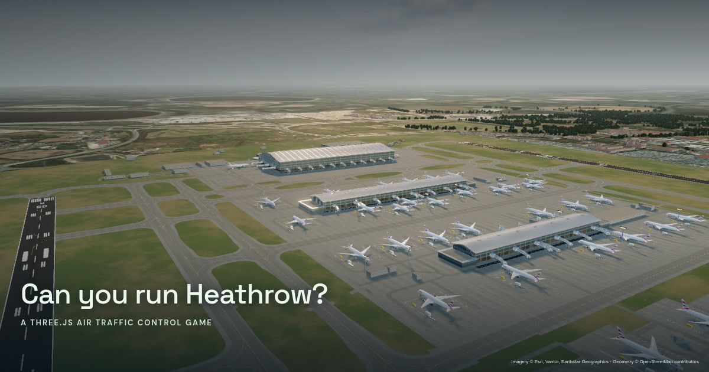

# Heathrow Control

**Two runways. One controller.** A playable, open-source Three.js air traffic control game inspired by Flight Control and [Piccadilly Line Driver](https://github.com/alexechoi/3js-tube-simulator).

**[Play](https://heathrow-simulator.alexchoi.xyz/)** · **[Watch the camera reel](https://heathrow-simulator.alexchoi.xyz/?demo)** · **[Download the 30-second MP4](https://heathrow-simulator.alexchoi.xyz/media/heathrow-flythrough.mp4)**



## Run locally

Requires Node.js 20.19+ or 22.12+ (Node 24 tested).

```sh
npm ci
npm run dev
# Open http://localhost:5173
npm run build
npm run preview
```

No API keys, server, live flight feed, tracking or paid assets are required. Fonts, skies, surface textures and aircraft are bundled or generated locally. The geographic basemap streams real Esri World Imagery at runtime, with visible attribution; it is a third-party service and is not covered by this repository’s code licence. A mapped procedural surface is used if imagery cannot load. OpenStreetMap geometry is bundled separately under ODbL.

## Play

1. Select **Take control**. Select a flight in the traffic list or click its label in the sky.
2. Clear **27R** (north) or **27L** (south). The aircraft joins a descending final approach and rolls out after touchdown.
3. Use **Hold** to delay an arrival, or **Go around** to cancel a clearance and climb away.
4. For Flight Control-style free routing, select **Draw route**, drag a vector path in the overhead view, then assign a runway to append its approach.
5. A safe arrival earns 100 points. A separation loss costs 50 points; three losses end the shift. Use the restart arrow for a new shift.

The first arrival is aligned with 27L and makes a good first landing. Avoid clearing nearby flights onto the same final. The alert monitor uses a deliberately compressed game threshold of **450 m horizontally and 90 m vertically**; this is not an operational separation standard. Runway selection is free-play, rather than Heathrow's actual segregated arrival/departure procedure.

| Control | Action |
| --- | --- |
| Mouse drag / touch drag | Orbit the airport; draw when route mode is active |
| Wheel / pinch | Zoom |
| 1 / 2 / 3 / 4 | Airport / tower / follow / overhead radar |
| Space | Pause / resume |
| H | Hide / show interface for screenshots |
| F | Enter / exit flythrough |
| M | Toggle synthesised radio readbacks |
| Escape | Exit flythrough / restore interface / cancel drawing |
| Golden hour button | Golden hour / daylight / blue hour |
| 1× button | Cycle simulation speed |

The base game clock advances two simulated seconds per real second. Traffic, weather, callsigns and origins are fictional scenario data. The displayed clock is scenario UTC, not wall-clock time. Browser speech synthesis availability and voices vary by device.

## What's modelled

- The parallel 09L/27R and 09R/27L runways, approximately 3,902 m and 3,660 m long, separated by approximately 1,420 m.
- Terminal 5's western main building and satellite concourses, the central Terminal 2/3 area, southern Terminal 4 and an 87 m tower, aligned with real geographic coordinates.
- Curved metal roofs, glass curtain walls, jet bridges, stands, ramp vehicles, parking structures, apron slabs and wear, taxiway centrelines, runway thresholds, touchdown markings, skid marks and approach lights.
- Procedural widebody airframes with tapered fuselages, swept wings, engines, fan details, windows, original geometric tail liveries, landing gear and navigation lights. The heavy variant adds four engines and an upper window row; the narrowbody is scaled. These are representative airframes, not manufacturer-exact models.
- 764 mapped airfield features and 2,787 OpenStreetMap building footprints; mapped woodland, real satellite surroundings, and a shared local Web Mercator coordinate frame. Building heights use OSM where available and estimates elsewhere. It is not a surveyed digital twin.
- Bundled CC0 photographic skies and asphalt/concrete/grass PBR textures; world-space material blending, roughness and normal maps, reflective glazing with procedural interior detail, brushed roof seams, HDR bloom, colour grading, MSAA, directional shadows and three lighting moods.
- Five camera sequences: airport reveal, arrival chase, Terminal 5 flyby, tower view and closing orbit.

This is a visual game, **not a flight dynamics or operational ATC trainer**. It does not implement real approach procedures, wake categories, real traffic, departure clearances or a taxiway-routing controller. Heathrow, NATS and the airlines do not endorse this project.

## Validation and capture

```sh
npm test                        # deterministic simulation tests
node scripts/e2e.mjs            # Chromium desktop + mobile interaction checks
# In another terminal: npm run preview -- --port 4173
npm run capture                 # 1280×720 / 24 fps / 30-second H.264 MP4
```

Browser scripts use `/usr/bin/chromium` by default. Set `CHROMIUM_PATH` to your Chromium executable, `TEST_URL` for browser tests, or `CAPTURE_URL` / `CAPTURE_OUT` for recording. The recorder advances the simulation by explicit frame times, so a slow capture machine does not produce a choppy output video. FFmpeg must be on PATH. Temporary screenshots go into ignored `work/screenshots/`.

The in-browser reel includes a blue-hour tower sequence and is 42 seconds; the exported video plays the same five shots at 1.4× pace. The MP4 is intentionally silent. `?demo` starts the reel; `?play` starts a shift; `?capture` freezes wall-clock animation for capture automation.

## Source layout

- `src/simulation.js` — pure game logic and separation checks.
- `src/geographic-airport.js` — mapped airport geometry, structures, scenery and instancing.
- `src/geography.js` — coordinate reference and runtime satellite tiles.
- `src/materials.js` / `src/postprocessing.js` — PBR surfaces, facade shaders and the HDR rendering pipeline.
- `src/terminal-architecture.js` / `src/runway-markings.js` — photo-studied terminal profiles and metre-scaled vector paint.
- `src/aircraft.js` — procedural airframes and liveries.
- `src/main.js` — renderer, interaction, cameras, radio and UI.
- `tests/` and `scripts/` — repeatable tests and recording.
- `docs/references.md` — photographic references and visual review notes.
- `netlify.toml` — static build and caching configuration.

## Deploy

Connect this repository to Netlify, use `npm run build`, and publish `dist`. Attach your hostname in Netlify domain management and point it to the site using your DNS zone. This deployment uses `heathrow-simulator.alexchoi.xyz` in Netlify DNS. Update the absolute Open Graph image URL in `index.html` if you host elsewhere.

## Licence and credits

Original code and procedural art: [Apache-2.0](LICENSE). Third-party assets keep their original licences; see [CREDITS.md](CREDITS.md). Inspiration is credited without copying the tube simulator's code or assets. [Slop New York](https://github.com/mrdoob/slop-newyork/) informed the layered material and lighting approach; this project uses its own WebGL2 shaders for broad browser support. Contributions welcome.
